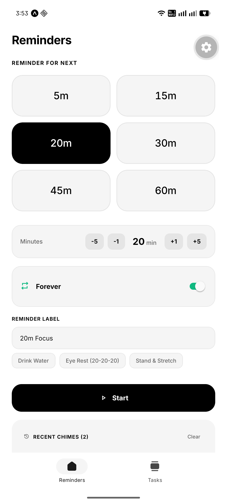
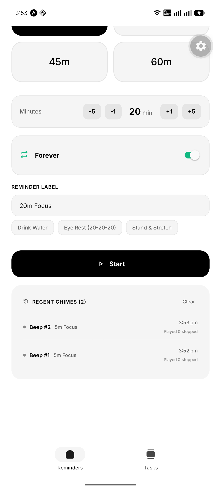
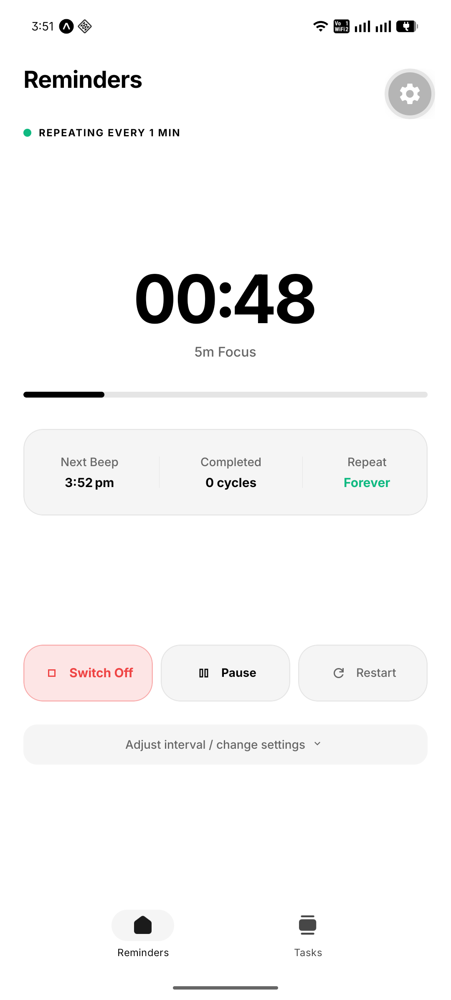
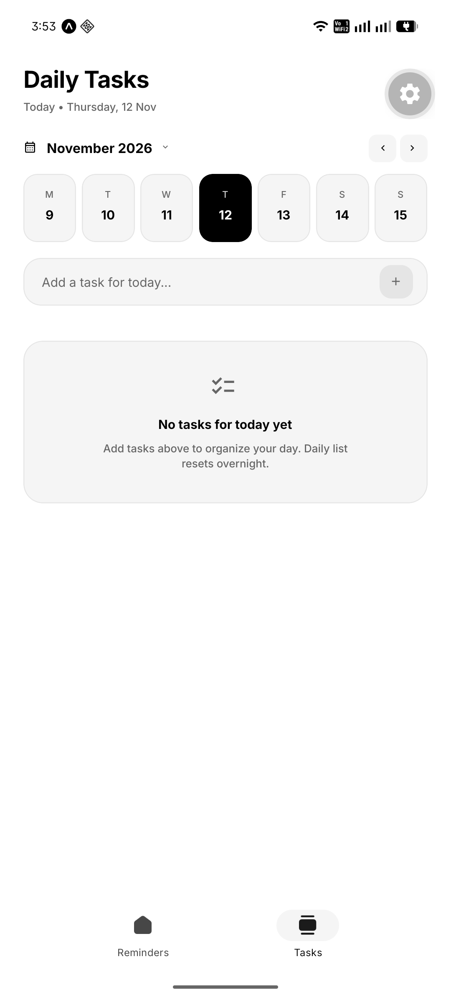
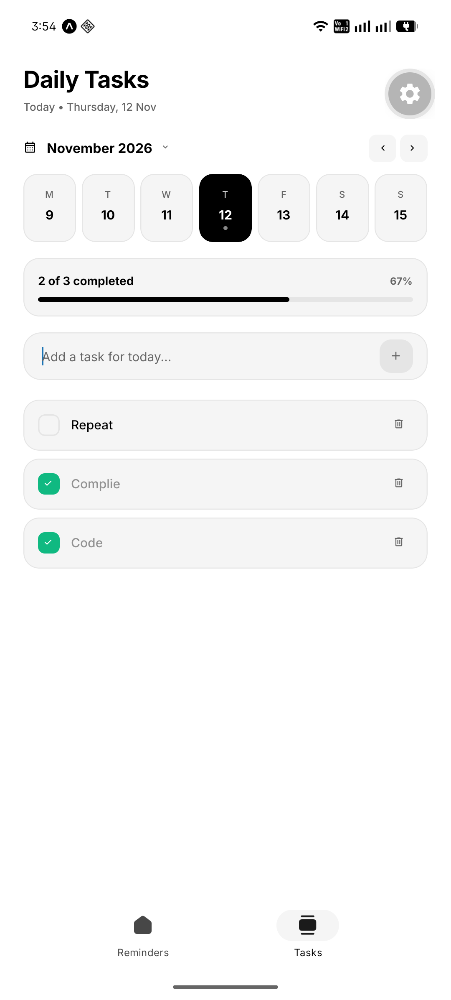
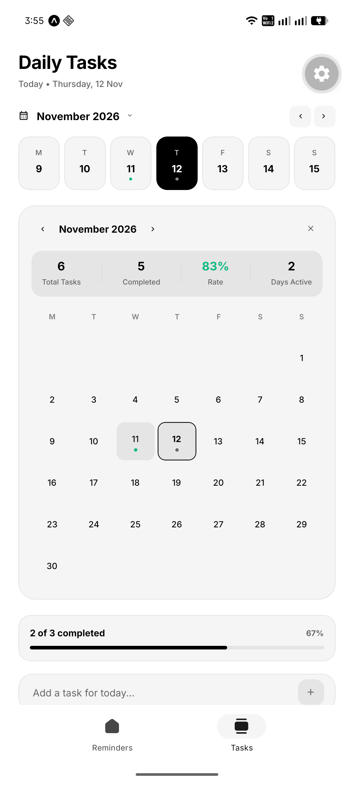

# Docket

<p align="center">
  <strong>A modern, minimalist daily companion for focused productivity, smart task tracking, and recurring interval reminders.</strong>
</p>

<p align="center">
  
  
  
  
  
  
</p>

---

## Overview

**Docket** combines frictionless daily task planning with lightweight recurring interval alarms in a unified, beautifully styled mobile application. Built with cross-platform performance in mind, Docket keeps you intentional about your daily goals and mindful of physical breaks (e.g. eye rest, hydration, posture checks) without the cognitive clutter of traditional productivity suites.

---

## Screenshots

| Interval Reminders Setup | Chime History Log | Active Countdown Timer |
| :---: | :---: | :---: |
|  |  |  |

| Daily Tasks View | Progress & Task Checklist | Month Archive & Analytics |
| :---: | :---: | :---: |
|  |  |  |

---

## Key Features

### 📅 Daily Tasks & Archive
- **Overnight Reset**: Daily task list automatically resets each morning while archiving your previous day’s completion history.
- **Midnight Rollover & Detection**: Intelligent day transition detection both on active runtime and background-to-foreground app state changes.
- **Unfinished Tasks Rollover**: One-tap banner prompt to roll over unfinished tasks from yesterday into today.
- **Interactive Date Strip**: Browse current and previous weeks with visual task-completion indicator dots and a quick "Go to Today" jump pill.
- **Monthly Calendar Archive**: Full-screen month view displaying day-by-day task volume and completion rates.
- **Frictionless Quick Add**: Instant keyboard-friendly task input with smooth tap persistence and Done key submission.

### ⏱️ Recurring Interval Reminders
- **Customizable Intervals**: Pre-configured quick presets (`5m`, `15m`, `20m`, `30m`, `45m`, `60m`) or fine-tuned minute steppers.
- **Non-Intrusive Chimes**: Non-looping alert beeps and pleasant audio feedback (`expo-audio` natively, synthesized Web Audio on web).
- **Background & Scheduled Notifications**: Reliable local notifications (`expo-notifications`) alerting you even when the app is in the background or device is locked.
- **Live Cycle Monitor**: Real-time progress bar, cycle count, upcoming chime timestamps, and controls to pause, resume, reset, or adjust on the fly.
- **Chime History Log**: Track recent alert timestamps and clear history whenever desired.

### 🎨 Design & Experience
- **Adaptive Appearance**: Automatic light and dark theme adaptation with high-contrast monochrome design accents.
- **Platform-Native Symbols**: Seamless icon integration using Apple SF Symbols on iOS and Material Symbols on Android and Web (`expo-symbols`).
- **Haptic Feedback**: Tactile feedback on completion, button presses, and task deletions (`expo-haptics`).
- **Safe Area & Edge-to-Edge**: Responsive layouts optimized for all modern device form factors and web viewports.

---

## Tech Stack

| Technology | Purpose |
| :--- | :--- |
| **[Expo SDK 58](https://expo.dev)** | Universal React framework & managed native runtime |
| **[React Native 0.88](https://reactnative.dev)** | Native mobile UI components |
| **[Expo Router v58](https://docs.expo.dev/router/introduction/)** | Type-safe, file-based navigation |
| **[Expo Audio](https://docs.expo.dev/versions/latest/sdk/audio/)** | Native audio playback engine for alerts |
| **[Expo Notifications](https://docs.expo.dev/versions/latest/sdk/notifications/)** | Local background notification management |
| **[AsyncStorage](https://react-native-async-storage.github.io/async-storage/)** | Offline-first, fast local persistence |
| **[Expo Symbols](https://docs.expo.dev/versions/latest/sdk/symbols/)** | SF Symbols (iOS) & Material Symbols (Android/Web) |
| **[TypeScript](https://www.typescriptlang.org/)** | Strict type safety and Developer Experience |

---

## Project Structure

```text
docket/
├── assets/
│   ├── images/              # Icons, adaptive icons, and splash assets
│   └── sounds/              # Alert chimes and notification audio
├── src/
│   ├── app/                 # Expo Router routes & screens
│   │   ├── _layout.tsx      # Root stack navigation and app setup
│   │   ├── index.tsx        # Reminders & Timer screen
│   │   └── explore.tsx      # Daily Tasks & Calendar screen
│   ├── components/
│   │   ├── reminder/        # ActiveTimer, ReminderForm, ReminderHistory
│   │   ├── tasks/           # TaskInput, TaskItem, DateStrip, MonthArchive
│   │   ├── themed-text.tsx  # Dynamic typography with theme colors
│   │   └── themed-view.tsx  # Dynamic view containers
│   ├── constants/
│   │   └── theme.ts         # Palette tokens, spacing, typography scales
│   ├── hooks/
│   │   ├── use-reminder.ts  # Interval timer state machine & notifications
│   │   ├── use-tasks.ts     # Task CRUD, index management & day rollover
│   │   └── use-theme.ts     # Dark/light scheme detection & colors
│   ├── services/
│   │   ├── notifications.ts # expo-notifications scheduling service
│   │   └── sound.ts         # Platform audio player & synthesized fallback
│   └── utils/
│       └── date.ts          # Local timezone date formatting & calendar math
├── app.json                 # Expo configuration & plugins
├── package.json             # Dependencies and build scripts
└── tsconfig.json            # TypeScript configuration
```

---

## Getting Started

### Prerequisites

- [Node.js](https://nodejs.org/) (v18.0.0 or later recommended)
- `npm` or `bun`
- [Expo Go](https://expo.dev/go) on your mobile device (iOS / Android) or local simulators (Xcode / Android Studio)

### Installation

1. Clone the repository:
   ```bash
   git clone https://github.com/your-username/docket.git
   cd docket
   ```

2. Install dependencies:
   ```bash
   npm install
   ```

### Running the App

Start the Expo development server:

```bash
npx expo start
```

From the terminal menu, press:
- `i` to launch in the **iOS Simulator**
- `a` to launch in the **Android Emulator**
- `w` to open in your default **Web Browser**
- Scan the printed QR code with your mobile camera (iOS) or the Expo Go app (Android)

---

## Development & Quality

Ensure code quality and consistency prior to committing changes:

```bash
# Typecheck TypeScript files
npx tsc --noEmit

# Lint codebase with Expo ESLint rules
npx expo lint

# Diagnose dependencies and environment configuration
npx expo-doctor
```

---

## Building with EAS

Docket uses **Expo Application Services (EAS)** for cloud builds and native compilation:

```bash
# Install EAS CLI globally or run via npx
npx eas-cli login

# Configure EAS project
npx eas-cli build:configure

# Build for Android (APK / AAB)
npx eas-cli build --platform android --profile preview

# Build for iOS (Simulator or TestFlight)
npx eas-cli build --platform ios --profile preview
```

---

## Architecture & Design Patterns

- **Offline-First**: All task lists, month summaries, and user reminder presets are stored locally in `AsyncStorage`. No mandatory sign-up or network connectivity required.
- **Robust Day Rollover**: Rather than relying purely on active timers, Docket compares local date strings upon every app resume (`AppState`), ensuring that even if your phone remained asleep overnight, tasks rollover seamlessly the moment you wake up your phone.
- **Safe Audio Handling**: Alerts initialize lazily and clean up properly when done to prevent audio-session conflicts with music or background media.
- **Continuous Native Generation**: Native iOS and Android project directories are managed declaratively via `app.json` plugins.

---

## License

This project is licensed under the [MIT License](LICENSE).
